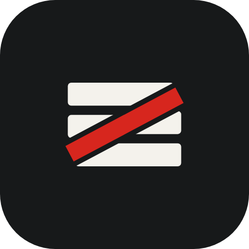
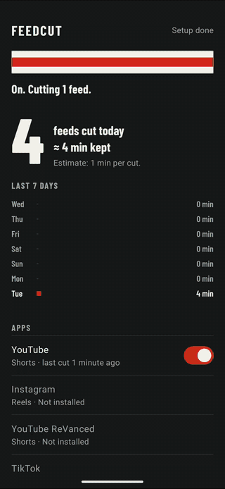
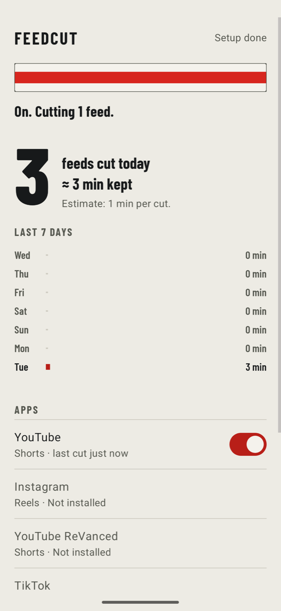
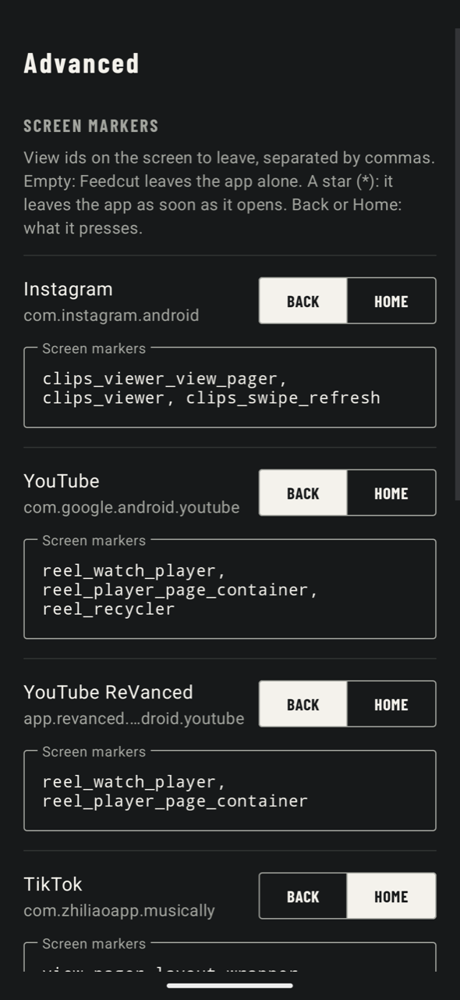

<p align="center"></p>

<h1 align="center">Feedcut</h1>

<p align="center">
An Android app that closes Instagram Reels, YouTube Shorts and TikTok the moment they open,<br>
and keeps Facebook to Marketplace and Groups. It has no internet permission.
</p>

<p align="center">
<a href="../../releases/latest"></a>
<a href="../../actions/workflows/build.yml"></a>
<a href="LICENSE"></a>

</p>

<p align="center">

&nbsp;

&nbsp;

</p>

<p align="center"><sub>Recorded on the Android 16 emulator. Video in the demo: <i>Big Buck Bunny</i>, © Blender Foundation, CC BY 3.0.</sub></p>

| App | What Feedcut does |
| --- | --- |
| Instagram | Leaves Reels. Feed, Stories, DMs and search work. |
| YouTube | Leaves Shorts. Normal videos, search and subscriptions work. |
| TikTok | Goes to the home screen when the video feed shows. Not yet confirmed on a device; see [Rule status](#rule-status). |
| Facebook | Switches Home, Reels, Video and every other tab to Marketplace. The ☰ menu and Groups work. |

## How it differs from other blockers

- **Facebook without the feed.** Most blockers either block Facebook or hide Reels. Feedcut keeps the parts people need, Marketplace and Groups, and takes away the feed.
- **No internet permission.** Check `AndroidManifest.xml`: there is no `INTERNET` permission, so Feedcut cannot send anything anywhere. No account, no analytics, no remote rules.
- **The rules are a file you can read.** Every blocked screen is a line in [`rules.json`](app/src/main/assets/rules.json). When an app renames a screen, the fix is a one-line pull request, and the in-app editor lets you fix it on your phone the same day.
- **It tells you when a rule may have broken.** Feedcut remembers the app version at the last screen it closed. If the app updates and nothing has been closed since, the main screen says so, without any network access.
- **App updates keep your settings.** A new Feedcut version brings new screen markers but keeps your switches and anything you edited.

## Install

1. Download the APK from [Releases](../../releases). You can also add this repository to [Obtainium](https://github.com/ImranR98/Obtainium) to get updates.
2. Open it and allow the install.

Every release is signed with the same key. To check that an APK is the real one (for example with [AppVerifier](https://github.com/soupslurpr/AppVerifier)), its signing certificate's SHA-256 is:

```
1E:FA:60:DC:75:B6:27:D3:E7:59:EC:F3:39:26:68:42:71:80:C1:24:24:DD:19:F1:3D:98:FC:39:A6:69:5E:AE
```

The build is reproducible: building the tagged commit gives the same APK as the release, apart from the signature. See [Verify a release](#verify-a-release).

Android 8.0 or newer (API 26).

## Setup

The order matters. Feedcut does nothing until all four steps are done.

1. **Turn on the accessibility service.** Open Feedcut and tap *Accessibility settings*, then switch Feedcut on.
2. **If the switch is greyed out** (Android 13 and later, for apps installed outside a store): go back to Feedcut, tap *App settings*, open the three-dot menu at the top right and choose *Allow restricted settings*. On some phones this menu item only appears after you have tried step 1 once. Then repeat step 1.
3. **Stop the phone from killing it.** In *App settings*, set battery usage to *Unrestricted*.
   - Xiaomi, Redmi, POCO (HyperOS, MIUI): *Battery saver: No restrictions* and *Autostart: on*. This is required. Without it HyperOS freezes Feedcut after a few minutes and blocking quietly stops. Feedcut has buttons for both screens.
   - OPPO, realme, OnePlus, vivo, iQOO, Huawei, Honor: one more background switch. Feedcut shows it as a setup step and opens your phone's page on [dontkillmyapp.com](https://dontkillmyapp.com).
   - Other phones: if blocking stops after a while, see [dontkillmyapp.com](https://dontkillmyapp.com). The Advanced screen links to your phone's page.
4. **Facebook only:** Marketplace has to be in your Facebook tab bar. If it isn't, add it in Facebook under Settings, Tab bar. Close Facebook once after installing or updating Feedcut, because a Facebook that was already running does not send events to a newly installed service.

## The rules file

```json
{
  "package": "com.instagram.android",
  "label": "Instagram",
  "enabled": true,
  "action": "back",
  "hints": ["clips_viewer", "clips_swipe_refresh"]
}
```

- `hints`: view ids on the screen you want to leave. Feedcut compares only the visible views' `view-id` with these. It does not read text or images.
- `*` as a hint: leave the whole app as soon as it opens.
- `action`: `back` presses Back, `home` goes to the home screen.
- `allowTabs`: for apps with a bottom tab bar. Only these tabs may stay selected, and Feedcut taps the first one when any other tab is selected. Facebook uses `["Marketplace"]`. This is the only place Feedcut reads labels: the bottom tab bar's tab names, nothing else.

Add any app you like from the in-app editor (*Rules file*).

## Rule status

Apps rename their screens without notice, so every rule has a date. If a rule here is older than a few months, treat it as unknown.

| Rule | Last checked | On |
| --- | --- | --- |
| Instagram Reels | 2026-11-02 | Xiaomi 17, HyperOS, Android 16 |
| Facebook tab bar | 2026-11-02 | Xiaomi 17, HyperOS, Android 16, Hungarian UI |
| YouTube Shorts | 2026-11-05 | Android 16 emulator, YouTube 21.42.243, release build |
| TikTok | not checked | |

When you confirm or fix a rule, update its row in the same pull request.

## When a rule stops working

Apps rename their screens. To find the new id, connect the phone with USB debugging, open the screen and run:

```bash
adb shell uiautomator dump /sdcard/screen.xml && adb pull /sdcard/screen.xml
grep -o 'resource-id="[^"]*"' screen.xml | sort -u
```

If the dump fails while a video plays, pause it first. Then open an issue with the *Broken rule* template, or send a pull request that changes `rules.json` and bumps its `version`.

Using a coding agent? [`AGENTS.md`](AGENTS.md) and the `fix-rule` skill walk it through the same steps.

## Who it works for

| Phone | Works? | What it needs |
| --- | --- | --- |
| Android 8.0 to 16 (API 26 to 36) | Yes | Tested on Android 16 (Xiaomi 17 and emulator) and Android 8.0 (emulator). Android 7 and older cannot install it. |
| Pixel, Motorola, Nokia, Sony, stock Android | Yes | The accessibility service and *Battery: Unrestricted*. |
| Samsung | Should work | *Battery: Unrestricted* also takes Feedcut off Samsung's sleeping apps list. Not tested on a Samsung yet. |
| Xiaomi, Redmi, POCO (MIUI, HyperOS) | Yes | Also *No restrictions* and *Autostart*, or HyperOS freezes Feedcut after a few minutes. Tested on a Xiaomi 17. |
| OPPO, realme, OnePlus, vivo, iQOO, Huawei, Honor | Should work | These systems have one more background switch. Feedcut shows it as a setup step with a link to the steps for your phone. Not tested. |

**Why it works on so many phones.** Feedcut uses only the standard accessibility API that has been in Android for years: it reads view ids and presses Back or Home. It needs no root, no Google services and no internet connection, so it also runs on phones without Google (custom ROMs, Huawei with apps from other stores). Most failures on a given phone come from the phone maker's battery manager stopping the service, which is why setup asks for the battery settings.

### It will not work

- **Instagram Lite and Facebook Lite.** They draw their own screens without view ids, so there is nothing to recognise.
- **Facebook in a language where the tab is not called "Marketplace".** `allowTabs` matches the label before the first comma ("Marketplace, tab 4 of 6"). In most languages, including English and Hungarian, it is "Marketplace". If yours differs, add your label to `allowTabs` in the rules file.
- **In a browser.** facebook.com, instagram.com and youtube.com work as usual.
- **With Advanced Protection on** (from Android 17). It turns off accessibility services that are not accessibility tools. Feedcut is not one and does not claim to be.
- **After an app update that renames a screen.** The main screen warns when this may have happened. See [When a rule stops working](#when-a-rule-stops-working).
- **TikTok** is not confirmed on a device yet.

### Installing outside a store

- **Android 13 and later** hide the accessibility switch for apps installed from a file until you allow restricted settings. Setup step 2 shows how.
- **Some countries block the install.** Where Play Protect's enhanced fraud protection is on (for example Singapore, India, Brazil, Thailand, Vietnam, Malaysia), Android refuses apps that ask for accessibility when they come from a browser, chat app or file manager. Installing through an app store client avoids this. Feedcut is being submitted to IzzyOnDroid and F-Droid.
- **Developer verification.** Since September 2026, phones in Brazil, Indonesia, Singapore and Thailand only install apps from verified developers, unless you turn on Android's one-time *advanced flow* (it has a one-day wait). Other countries follow from 2027. Feedcut's developer is not verified yet.
- **It is an accessibility service, not a lock.** You can switch it off in a few taps. It helps against habit, not against determination. Feedcut never acts on itself, Settings or the system screens, so a rule cannot lock you out.

## Privacy

Feedcut asks the system for events only from the apps you switch on. It reads view ids, and for `allowTabs` the bottom tab bar's labels. It stores your rules and a daily counter on the phone. Backup is off, so uninstalling removes everything. There is no network code.

## Build

```bash
./gradlew :app:testDebugUnitTest :app:assembleDebug
```

JDK 17 or newer; releases are built with JDK 21. The APK is at `app/build/outputs/apk/debug/app-debug.apk`.

For a signed release, create `keystore.properties` in the project root (it is git-ignored):

```properties
storeFile=release.jks
storePassword=...
keyAlias=feedcut
keyPassword=...
```

Release builds are shrunk with R8 (about 1.6 MB). Releases are built and signed by the maintainer from the tagged commit.

### Verify a release

Without `keystore.properties`, `assembleRelease` gives an unsigned APK. Build the tag with JDK 21, then let [apksigcopier](https://github.com/obfusk/apksigcopier) check that the release is your build plus the maintainer's signature:

```bash
git checkout v1.1.0
./gradlew :app:assembleRelease
apksigcopier compare feedcut-v1.1.0.apk --unsigned app/build/outputs/apk/release/app-release-unsigned.apk
```

No output and exit code 0 means the APKs match. `apksigcopier` needs `apksigner` from the Android build tools on the `PATH`.

CI can sign releases too. It is off until the repository variable `CI_RELEASE` is `true`; then pushing a `v*` tag builds a signed APK and attaches it to a release. It needs the secrets `FEEDCUT_STORE_BASE64`, `FEEDCUT_STORE_PASSWORD`, `FEEDCUT_KEY_ALIAS` and `FEEDCUT_KEY_PASSWORD` in a protected `release` environment.

## Contributing

Rule fixes are the most useful contribution: see [CONTRIBUTING.md](CONTRIBUTING.md). Security problems go through [SECURITY.md](SECURITY.md), not public issues. Changes are listed in [CHANGELOG.md](CHANGELOG.md).

## License

[Apache-2.0](LICENSE). You may use, change and share Feedcut, also inside your own apps, as long as you keep the license and say what you changed.
